# SMR: Smart Model Router for Codex and Claude Code

[English](README.md) · [Tiếng Việt](README.vi.md) · [Quick start](docs/QUICKSTART.md) · [Website](https://smr.acmeai.vn/)

**Stop paying frontier-model prices for work a cheaper model can do.**

SMR is an open-source local LLM router for Codex and Claude Code. It reads the task you just gave the agent, asks ACME AI's classifier for one of four difficulty tiers, and sends the request to the model you configured for that tier. It preserves the prompt and native API format, changing only the request's `model` field.

Provider API keys are stored locally and sent only to your configured provider. Model traffic goes directly from SMR to that provider. ACME AI sells the classification decision; your provider bills model usage separately.

## Start here

You need your own provider API key and a funded [ACME AI account](https://llm.acmeai.vn/). The client is Apache-2.0; classification and provider tokens are billed separately. ChatGPT Plus sessions and Claude Pro OAuth sessions cannot be used through SMR.

| I want to… | Start with |
|---|---|
| Set up Codex | [Codex quick start](docs/QUICKSTART.md#codex) |
| Set up Claude Code | [Claude Code quick start](docs/QUICKSTART.md#claude-code) |
| Install directly on Windows, macOS or Linux | [Direct installation](docs/QUICKSTART.md#direct-installation) |
| Understand cost, privacy and fallback behavior | [Cost and privacy guide](docs/COST-AND-PRIVACY.md) |
| Đọc hướng dẫn bằng tiếng Việt | [README tiếng Việt](README.vi.md) |

## What it does

1. **Read one representative text.** SMR extracts the last user message from the request body, falling back to the last assistant message when there is no user text. It does not select system messages or tool-result blocks as classifier text. Long states are truncated at `max_chars` (12,000 by default). Sensitive content pasted into a user message can be included.
2. **Ask for a tier.** That text goes to `https://api.acmeai.vn/v1/classify` with the host name. The answer is one of four tiers, plus the charge in VND and your remaining balance.
3. **Route to your configured model.** SMR changes the `model` field and sends the request to the base URL and provider key configured for that tier. The prompt and the host's native API format are preserved.
4. **Report what happened.** Every response carries `X-SMR-Tier`, `X-SMR-Cache`, `X-SMR-Charged-VND`, `X-SMR-Balance-VND`, and `X-SMR-Classifier`, and the same decision appears on the dashboard ledger at `llm.acmeai.vn`.

| Tier | Work that usually lands here | Model slot you assign |
|---|---|---|
| `easy` | renames, formatting, small edits, questions about code that already exists | cheapest capable model |
| `lower_medium` | a single-file feature, test updates, routine refactors | balanced model |
| `upper_medium` | multi-file changes, debugging across modules | strong model |
| `hard` | architecture, tricky migrations, long debugging chains | strongest model |

The tier-to-model mapping is yours. SMR ships no model list and never changes that mapping for you.

- **Four tiers, fixed.** The scale never changes, so a decision stays comparable from one request to the next.
- **Separate native profiles** for Codex Responses and Claude Messages. No format translation between OpenAI and Anthropic.
- **No local Jev key.** SMR calls the classifier with your ACME AI API key, and that key only pays for the classification decision.
- **Server-side cache.** An identical state inside the cache window costs 10% of the first classification charge, with a 1 VND minimum.
- **Stop on insufficient classification balance.** When the classifier returns 402, SMR stops before calling a provider model.

## Why use it

- **Spend less on tokens.** Easy work stops buying a frontier model. You pay four possible prices instead of one, and the price of each tier is your own choice of model.
- **Keep your stack.** Your provider accounts, your keys, your model names. No translation layer between OpenAI and Anthropic, so streaming, tool calls, and reasoning blocks stay native.
- **See every decision.** Tier, cache state, charge, and balance arrive as response headers and on the dashboard ledger. A routing decision is visible, not implied.
- **Keep provider credentials under your control.** The classifier receives the last user text, or the last assistant text when user text is absent, truncated to `max_chars`. Provider keys and the full conversation are not sent to ACME AI. The selected provider receives the model request. See [the data flow](docs/COST-AND-PRIVACY.md#what-leaves-your-machine).
- **One key, two hosts.** A single ACME AI key and one local config serve Codex and Claude Code, with an independent model mapping for each.
- **No lock-in on your editor.** SMR is a local HTTP endpoint. Any host that accepts a custom base URL and an API key can use it, and removing it is one config edit.

An illustrative calculation: if 60% of token spend can move to an easy-tier model costing a tenth as much, and the rest stays on the hard-tier model, provider spend falls from 100 units to 46. This assumes the same token usage and excludes classification fees and retries; it is not a measured saving. Your result depends on model mapping, token usage and output quality. See [how to evaluate total cost](docs/COST-AND-PRIVACY.md#measure-total-cost).

How you pay: ACME AI charges each classification against your prepaid VND balance (a cache hit costs 10% of the first charge, with a 1 VND minimum). Your model tokens are billed by your own provider, directly to your own account. SMR never touches model billing.

## Requirements

| Host | Required | Not supported |
|---|---|---|
| Codex | Provider API key configured in Codex | ChatGPT Plus session |
| Claude Code | Anthropic-compatible API key or token | Claude Pro OAuth session |
| OS | Windows 11, macOS 14+, Ubuntu 22.04+ | 32-bit systems |

Claude Code must be able to reach an Anthropic-compatible API with an API key. A Claude Pro login is not an API key and cannot be routed through SMR.

## Install

| Path | Entry point | Use it when |
|---|---|---|
| Plugin marketplace URL | `codex plugin marketplace add https://github.com/acmeai-vn/SMR` or `/plugin marketplace add https://github.com/acmeai-vn/SMR` | You use Codex or Claude Code and want the agent to walk through setup |
| Direct URL installer | `curl -fsSL https://raw.githubusercontent.com/acmeai-vn/SMR/main/install.sh \| sh` or `irm https://raw.githubusercontent.com/acmeai-vn/SMR/main/install.ps1 \| iex` | CI, scripted setup, or a host without plugin support |

Both paths install the same daemon, use the same configuration file, and open the same setup flow. The plugin does not contain routing logic.

## Install from a URL

It installs the `smr` binary, registers a per-user background service, and opens the local setup page. It never edits Codex or Claude Code configuration; step 3 shows the exact blocks you add yourself.

### macOS and Linux

    curl -fsSL https://raw.githubusercontent.com/acmeai-vn/SMR/main/install.sh | sh

Install a specific version:

    curl -fsSL https://raw.githubusercontent.com/acmeai-vn/SMR/main/install.sh | sh -s -- --version v0.1.0

Install without opening the setup page:

    curl -fsSL https://raw.githubusercontent.com/acmeai-vn/SMR/main/install.sh | sh -s -- --no-setup

### Windows

Run PowerShell as your normal user. No administrator rights are required. When a machine denies
scheduled-task creation, the installer falls back to a shortcut in the per-user Startup folder,
which starts SMR at logon the same way. The installer never writes `HKCU\...\Run`: Windows
Defender classifies an unsigned binary that adds a Run entry as
`Behavior:Win32/Persistence.A!ml` and quarantines it.

If Defender quarantined an older build, clear the detection from protection history, add the
install folder as an exclusion from an elevated PowerShell, and install again:

    Add-MpPreference -ExclusionPath "$env:LOCALAPPDATA\AcmeAI\SMR"

    irm https://raw.githubusercontent.com/acmeai-vn/SMR/main/install.ps1 | iex

Install a specific version:

    $env:SMR_VERSION = "v0.1.0"
    irm https://raw.githubusercontent.com/acmeai-vn/SMR/main/install.ps1 | iex

Install without opening the setup page:

    $env:SMR_NO_SETUP = "1"
    irm https://raw.githubusercontent.com/acmeai-vn/SMR/main/install.ps1 | iex

### Installer behavior

1. Detects OS and CPU architecture.
2. Downloads `smr-release.json` and the platform archive from GitHub Releases.
3. Verifies the archive SHA-256 before extracting or replacing anything.
4. Installs `smr` under your user:
   - Windows: `%LOCALAPPDATA%\AcmeAI\SMR\smr.exe`
   - macOS: `~/Library/Application Support/AcmeAI/SMR/smr`
   - Linux: `~/.local/share/acmeai/smr/smr`
5. On macOS/Linux, creates `~/.local/bin/smr` as a symlink. It never overwrites a regular file with that name.
6. Registers a per-user background service:
   - Windows: Task Scheduler at logon, or a shortcut in the per-user Startup folder when task creation is denied.
   - macOS: LaunchAgent `vn.acmeai.smr`.
   - Linux: `systemd --user` unit `smr.service`.
7. Starts SMR on `127.0.0.1:8787` and its local UI on `127.0.0.1:8788`.
8. Waits for `GET /health` before reporting success. `--no-service` skips the wait, because the binary is installed but not started.
9. Opens `smr setup` with a one-time token unless `--no-setup` or `--no-service` is set.

The installer never writes provider keys into logs and never sends them to ACME AI. Running it again upgrades the binary, stops the old daemon, and restarts the service without deleting your configuration.

If `~/.local/bin` is not on your `PATH`, add it or invoke the absolute path printed by the installer.

### Manual verification

Every release publishes the archive, `smr-vX.Y.Z-checksums.txt`, and `smr-release.json`. To verify a manual download:

    sha256sum smr-v0.1.0-linux-amd64.tar.gz
    # compare with smr-v0.1.0-checksums.txt

On macOS use `shasum -a 256` instead. The phase 1 release manifest is not cryptographically signed; integrity relies on HTTPS plus the published SHA-256 values. See `docs/RELEASE.md` for the publishing flow.

## Install as an agent plugin

SMR is distributed as a marketplace plugin for Codex and Claude Code. Add the marketplace by URL; you do not need to clone the repository or know a local path. The plugin is a bootstrap and launcher: it registers the SMR setup workflow, and that workflow installs or updates the local daemon after showing the installer URL and getting confirmation. Routing still happens in the local daemon, not inside the agent process.

Installing the plugin by itself does not edit Codex or Claude Code configuration. The setup skill detects both hosts and shows the exact blocks to add; you make the edit yourself.

### Codex

    codex plugin marketplace add acmeai-vn/SMR
    codex plugin add smart-model-router@acmeai-smr

Or use the full Git URL:

    codex plugin marketplace add https://github.com/acmeai-vn/SMR
    codex plugin add smart-model-router@acmeai-smr

Then ask Codex to set up Smart Model Router and follow the skill instructions.

### Claude Code

Inside a Claude Code session:

    /plugin marketplace add acmeai-vn/SMR
    /plugin install smart-model-router@acmeai-smr

Or use the full Git URL:

    /plugin marketplace add https://github.com/acmeai-vn/SMR
    /plugin install smart-model-router@acmeai-smr

Then invoke the SMR skill and follow its setup flow. The flow prints the blocks to add; you apply them and restart Claude Code yourself.

### What the plugin does not do

- It does not contain a second router.
- It does not modify `~/.codex/config.toml` or `~/.claude/settings.json` at all.
- It does not ask you to paste an API key, provider key, OAuth token, or session token into chat.
- It does not set SMR as the default provider silently.

## First run

    smr setup

The setup page is a four-step flow:

Opening `http://127.0.0.1:8788` by hand shows a short page explaining that the
setup UI needs the token printed by `smr setup`. That is intentional: a random
website in your browser must not be able to rewrite the local SMR config. If the
daemon is not running, `smr setup` starts it before opening the browser.

1. **Kết nối ACME AI** — the classifier base URL and your ACME AI API key
   (`acme_sk_...`). If you do not have a key yet, the page links to the dashboard
   for your environment (`llm.acmeai.vn`, or `llm-testing.acmeai.vn` when the base
   URL is the testing API) in a new tab, where you sign up, top up, and create the
   key. A key that passes the connection check is saved immediately.
2. **Chọn model cho từng tier** — four tiers for the Codex profile and four for
   the Claude Code profile, in separate tabs.
3. **Cài vào agent** — what to add to `~/.codex/config.toml` and
   `~/.claude/settings.json`, as copy-ready blocks. SMR never writes those
   files: you paste the blocks, check the result, and restart the host.
4. **Kiểm tra** — live counters for requests, the last tier and charge, and cache
   hits, plus a link to the log.

The step markers at the top turn green as each step is satisfied, so you can see
at a glance what is still missing.

The setup page is available in Vietnamese and English, with Vietnamese as the
default. The `VI`/`EN` switch in the header stores the choice in a cookie, so the
page keeps the same language on the next visit. Switching language keeps the
selected profile tab.

The API key is stored in the SMR configuration file with user-only permissions. The full key is shown only once on `llm.acmeai.vn`; SMR cannot recover it later.

The setup token is written to the data directory (`ui-token`) and is valid only for this process. Logs and the single-instance pid file live in the same directory. On Windows and macOS the directory is under the per-user Application/Local data folder; on Linux it follows `XDG_DATA_HOME` and defaults to `~/.local/share/acmeai/smr`.

Useful commands:

    smr version
    smr status
    smr doctor
    smr restart
    smr update
    smr logs --tail 100
    smr uninstall

`smr serve` is the foreground process used by the background service. You normally do not run it directly.

## Host configuration

SMR never writes the Codex or Claude Code configuration files. A duplicate
`model_provider` or a second `ANTHROPIC_API_KEY` can break a working setup in
ways SMR cannot see, so the setup page shows the exact blocks and you apply
them. Nothing here is needed if you already point the host at another router.

### Codex

Add the provider block and, separately, the default provider key:

    [model_providers.smr]
    name = "Smart Model Router"
    base_url = "http://127.0.0.1:8787/v1"
    wire_api = "responses"

Put `model_provider = "smr"` at the top of the file, before any `[table]`.
TOML reads a top-level key that appears after a table as part of that table, so
appending it at the end silently changes its meaning. SMR does not add that
line itself; you decide whether to make SMR the default.

### Claude Code

Add these two entries to the existing `env` object in `settings.json`; do not
replace the whole file:

    "ANTHROPIC_BASE_URL": "http://127.0.0.1:8787",
    "ANTHROPIC_AUTH_TOKEN": "smr-local-placeholder"

The placeholder is not a secret. SMR replaces it with the Claude profile key
when forwarding the request. Restart Claude Code after the edit.

If you only configure one host, SMR still runs and that host can use it.

## Configuration

### Testing environment

Use `https://api-testing.acmeai.vn` and an API key created on
`https://llm-testing.acmeai.vn`. Do not reuse a production key.

    classifier:
      base_url: "https://api-testing.acmeai.vn"
      api_key: "acme_sk_testing_key"

`ACMEAI_BASE_URL` overrides `classifier.base_url` without editing the file.
`config.testing.example.yaml` is a complete testing starting point, and
`docs/TESTING.md` lists the verification steps and exit criteria.

Default locations:

| OS | Config |
|---|---|
| Windows | `%LOCALAPPDATA%\AcmeAI\SMR\config.yaml` |
| macOS | `~/Library/Application Support/AcmeAI/SMR/config.yaml` |
| Linux | `${XDG_DATA_HOME:-~/.local/share}/acmeai/smr/config.yaml` |

`ui-token`, `daemon.pid` and `smr.log` live in the data directory above, not
necessarily beside the config file: `SMR_CONFIG` moves only the file. The
config path and data directory can be overridden with `SMR_CONFIG` and
`SMR_DATA_DIR`.

A complete, commented example is in `config.example.yaml`. Minimal shape:

    listen: "127.0.0.1:8787"
    ui_listen: "127.0.0.1:8788"

    classifier:
      base_url: "https://api.acmeai.vn"
      api_key: ""                 # or ACMEAI_API_KEY
      timeout_ms: 15000
      max_chars: 12000
      retry: 1
      on_transient_error: fallback
      fallback_tier: upper_medium

    profiles:
      codex:
        api: responses
        auth: bearer
        tiers:
          easy:         { base_url: "https://provider.example/v1", api_key: "...", model: "..." }
          lower_medium: { base_url: "https://provider.example/v1", api_key: "...", model: "..." }
          upper_medium: { base_url: "https://provider.example/v1", api_key: "...", model: "..." }
          hard:         { base_url: "https://provider.example/v1", api_key: "...", model: "..." }

      claude:
        api: messages
        auth: x-api-key
        anthropic_version: "2023-06-01"
        tiers:
          easy:         { base_url: "https://api.anthropic.com", api_key: "...", model: "..." }
          lower_medium: { base_url: "https://api.anthropic.com", api_key: "...", model: "..." }
          upper_medium: { base_url: "https://api.anthropic.com", api_key: "...", model: "..." }
          hard:         { base_url: "https://api.anthropic.com", api_key: "...", model: "..." }

Configuration rules:

- SMR binds only to loopback. It refuses to start on a public interface.
- Config files are readable only by the current user. On Windows SMR resets the ACL with `icacls` and grants the current user because `chmod` does not change Windows ACLs.
- `ACMEAI_API_KEY` overrides `classifier.api_key`.
- `max_chars` must not exceed the server limit returned by `GET /v1/account`.
- `count_tokens` is served by the Claude `easy` tier and does not call the classifier.

Each response includes `X-SMR-Tier`, `X-SMR-Cache`, `X-SMR-Charged-VND`, `X-SMR-Balance-VND` and `X-SMR-Classifier` so a client can verify what happened without exposing prompts.

## Billing behavior

- You are charged per classification, in whole VND.
- A cache hit costs 10% of the original charge, minimum 1 VND.
- The server rounds up; the minimum charge is 1 VND.
- A cache entry lives for 5 minutes.
- If your balance is insufficient, SMR returns 402 and does not call a model. It does not silently fall back to a more expensive model.
- There is no refund policy. A topped-up balance does not expire and is used until it runs out.
- A transfer that arrives after the 30-minute QR window is still credited. Overpayments stay in the balance; underpayments credit the amount received; only a transfer whose order code cannot be matched goes to reconciliation.

Top-up plans: 20,000 / 50,000 / 100,000 VND via TP Bank QR. The QR is shown for 30 minutes; the order code remains usable after that. The 50,000 VND plan is highlighted by default.

## Update and rollback

    smr update
    smr update --check
    smr update --version v0.1.0

`smr update` reads the release manifest, verifies the new archive, and asks before replacing the running binary. It stops the old daemon first, so the new build can bind the loopback port. The previous binary is kept for rollback; rolling back does not touch configuration.

To reinstall a specific version with the URL installer:

    curl -fsSL https://raw.githubusercontent.com/acmeai-vn/SMR/main/install.sh | sh -s -- --version v0.1.0 --no-setup

## Troubleshooting

    smr doctor
    smr status
    smr logs --tail 100

Common cases:

- **Claude Code returns 401:** the Claude profile needs an Anthropic-compatible API key/token. Claude Pro OAuth is not supported.
- **Codex cannot find the provider:** restart Codex after `smr setup` confirms the change.
- **402 from SMR:** top up at `https://llm.acmeai.vn/topup`. SMR will not call a model without balance.
- **Port already in use:** change `listen` and `ui_listen`, save, then update the host base URL to match the new port. Run `smr restart` afterwards.
- **Installer cannot find a release:** check that a tag and its release assets exist on GitHub Releases, then retry without `--version`.
- **Installer checksum mismatch:** do not run the archive. Delete it and download again; report the release tag and asset name privately.
- **macOS Gatekeeper blocks the binary:** phase 1 releases are not signed or notarized. Verify the checksum and follow the published install instructions. Signing is out of scope for phase 1.
- **Windows scheduled task blocked by policy:** the installer already falls back to a per-user
  Startup-folder shortcut, so no action is needed. If autostart is blocked entirely, run
  `smr serve` manually from a terminal.
- **Windows Defender quarantines `smr.exe`:** releases up to v0.1.1 added a `HKCU\...\Run` entry,
  which Defender classifies as persistence malware. Upgrade to v0.1.2 or later, remove the
  detection from protection history, and add the install folder with
  `Add-MpPreference -ExclusionPath "$env:LOCALAPPDATA\AcmeAI\SMR"` from an elevated PowerShell.
- **Two SMR builds on one machine:** each build needs its own `listen`/`ui_listen` port, its own
  config file and its own data directory, because `daemon.pid` and `ui-token` are per data
  directory. Set both `SMR_CONFIG` and `SMR_DATA_DIR`; `SMR_CONFIG` alone still shares the lock,
  so the second build's daemon exits with "another SMR daemon is already running".

## Uninstall

    smr uninstall

This removes the background service. Add `--purge` to remove the SMR
configuration and cached state as well. SMR never edited your host files, so
there is nothing to restore; revert the blocks from the setup page by hand if
you want to stop routing through SMR.

## Security and privacy

- SMR sends only one representative text to `api.acmeai.vn`.
- The server stores a hash, tier, token count, price, and timestamps; it does not store the raw text.
- Provider credentials are stored locally and sent only to the configured provider. The ACME AI key authenticates requests to the classifier.
- SMR never logs raw prompts, API keys, or OAuth tokens.
- The local UI binds only to loopback and requires a one-time token.
- On Windows, SMR configuration and token files receive an explicit current-user-only ACL. On macOS and Linux they use `0600`/`0700` permissions.
- Source code is available under Apache-2.0.

## Development

    go test ./...
    go vet ./...
    go build ./cmd/smr

Release packaging is documented in `docs/RELEASE.md`.

## Feedback and contributions

Found an installation problem or a routing decision worth investigating? [Open an issue](https://github.com/acmeai-vn/SMR/issues/new) with your OS, SMR version, host, expected behavior and a redacted example. Remove API keys, setup tokens and private prompt content before posting.

If SMR is useful to you, a star helps you bookmark the project. Sharing the [quick start](docs/QUICKSTART.md) with someone who pays for coding-agent API usage helps them decide whether it fits their setup.

## License

Apache-2.0. See `LICENSE`.
