# SMR: Smart Model Router cho Codex và Claude Code

[English](README.md) · [Hướng dẫn chi tiết](docs/QUICKSTART.md) · [Website](https://smr.acmeai.vn/) · [Tải bản phát hành](https://github.com/acmeai-vn/SMR/releases/latest)

**Việc dễ không cần model đắt.**

SMR là công cụ định tuyến LLM mã nguồn mở, chạy trên máy của bạn. Với mỗi request từ Codex hoặc Claude Code, SMR gửi một đoạn text tiêu biểu tới bộ phân loại của ACME AI, nhận mức độ khó rồi gọi model bạn đã gán cho mức đó.

Bạn chọn model, nhà cung cấp và API key. SMR giữ nội dung prompt cùng định dạng API của host, chỉ đổi trường `model` khi gửi request tới nhà cung cấp.



## SMR phù hợp với ai?

- Bạn dùng Codex hoặc Claude Code qua API và tự trả phí model.
- Bạn muốn việc sửa nhãn, đổi tên biến hoặc giải thích hàm có thể chạy model nhẹ hơn.
- Bạn muốn giữ model mạnh cho công việc khó và kiểm tra quyết định định tuyến.

SMR cần API key của nhà cung cấp model. Phiên đăng nhập ChatGPT Plus và Claude Pro OAuth không dùng qua SMR.

## Bốn mức độ khó

| Tier | Ví dụ công việc | Model do bạn gán |
|---|---|---|
| `easy` | Định dạng, đổi tên, chỉnh sửa nhỏ | Model nhẹ |
| `lower_medium` | Tính năng trong một file, cập nhật test | Model cân bằng |
| `upper_medium` | Thay đổi nhiều file, gỡ lỗi qua nhiều module | Model mạnh |
| `hard` | Kiến trúc, migration khó, chuỗi gỡ lỗi phức tạp | Model mạnh nhất bạn chọn |

Đây là ví dụ để hiểu cơ chế, không phải cam kết mọi tác vụ sẽ nhận đúng tier như bảng. SMR không cung cấp sẵn danh sách model và không tự thay cách bạn gán model.

## Chi phí cần biết trước khi cài

Phần mềm SMR dùng giấy phép Apache-2.0. Dịch vụ phân loại ACME AI và phí token của model được tính riêng:

- **ACME AI:** trừ phí phân loại từ số dư nạp trước, bằng VNĐ. Cache hit trong cửa sổ 5 phút tính 10% phí gốc, làm tròn lên, tối thiểu 1 đồng.
- **Nhà cung cấp model:** tính phí theo tài khoản và model bạn đã cấu hình.

Đăng nhập tại [llm.acmeai.vn](https://llm.acmeai.vn/), nạp tiền rồi tạo API key ACME AI. Các mức nạp là 20.000 / 50.000 / 100.000 đồng. Nhập key ở giao diện cài đặt trên máy; không gửi key vào chat.

Mức tiết kiệm phụ thuộc công việc, lượng token, model đã gán và chất lượng đầu ra. Khi so sánh, cộng cả phí phân loại lẫn các lần chạy lại. [Xem cách đo tổng chi phí](docs/COST-AND-PRIVACY.md#measure-total-cost).

## Cài SMR

Hỗ trợ Windows 11, macOS 14+ và Ubuntu 22.04+, kiến trúc 64-bit. Chọn một trong các cách dưới đây; tất cả dùng chung daemon SMR.

### Cài cho Codex

Chạy trong terminal có Codex:

```text
codex plugin marketplace add https://github.com/acmeai-vn/SMR
codex plugin add smart-model-router@acmeai-smr
```

Sau đó yêu cầu Codex: “Thiết lập Smart Model Router.” Làm theo workflow để cài daemon và mở giao diện thiết lập trên máy.

### Cài cho Claude Code

Chạy bên trong Claude Code:

```text
/plugin marketplace add https://github.com/acmeai-vn/SMR
/plugin install smart-model-router@acmeai-smr
```

Gọi skill SMR và làm theo hướng dẫn thiết lập.

### Cài trực tiếp trên Windows

Mở PowerShell bằng tài khoản người dùng bình thường:

```powershell
irm https://raw.githubusercontent.com/acmeai-vn/SMR/main/install.ps1 | iex
```

### Cài trực tiếp trên macOS hoặc Linux

```sh
curl -fsSL https://raw.githubusercontent.com/acmeai-vn/SMR/main/install.sh | sh
```

Bạn có thể đọc [installer PowerShell](install.ps1) hoặc [installer shell](install.sh) trước khi chạy. Installer kiểm tra SHA-256 của gói phát hành rồi cài dịch vụ chạy nền cho tài khoản hiện tại.

## Thiết lập lần đầu

Nếu đã đóng giao diện cài đặt, mở lại bằng:

```text
smr setup
```

1. **Kết nối ACME AI:** nhập API key ACME AI trên trang cục bộ.
2. **Chọn model:** cấu hình base URL, API key nhà cung cấp và model cho đủ bốn tier của host bạn dùng. Codex và Claude Code có profile riêng.
3. **Cài vào agent:** sao chép các khối cấu hình được hiển thị vào file của host, giữ các thiết lập đang có. SMR không tự sửa file cấu hình Codex hoặc Claude Code.
4. **Kiểm tra:** khởi động lại host, chạy một tác vụ nhỏ rồi xem bộ đếm request, tier, phí và cache ở bước cuối.

Với Codex, `model_provider = "smr"` phải nằm ở cấp cao nhất trong TOML, trước các `[table]`. Với Claude Code, ghép các mục được hướng dẫn vào object `env` hiện có. [Xem hướng dẫn theo từng host](docs/QUICKSTART.md).

## Dữ liệu nào được gửi đi?

- Bộ phân loại ACME AI nhận text người dùng cuối cùng; nếu không có thì dùng text trợ lý cuối cùng. Giới hạn mặc định là 12.000 ký tự. Với Responses input dạng chuỗi, SMR dùng chuỗi đó.
- SMR không chọn system message hay tool-result block làm text phân loại. Nội dung nhạy cảm bạn dán vào tin nhắn người dùng vẫn có thể nằm trong phần gửi đi.
- API key nhà cung cấp được lưu trên máy và chỉ gửi tới nhà cung cấp đã cấu hình. Toàn bộ cuộc hội thoại không được gửi tới endpoint phân loại.
- Request model đi từ máy bạn tới nhà cung cấp. Đây là workflow có gọi bộ phân loại trên cloud.

Đọc [luồng dữ liệu và xử lý lỗi](docs/COST-AND-PRIVACY.md) cùng [chính sách riêng tư của dịch vụ](https://llm.acmeai.vn/privacy) trước khi dùng với dữ liệu công việc.

## Kiểm tra và xử lý lỗi

```text
smr version
smr status
smr doctor
smr logs --tail 100
```

| Hiện tượng | Kiểm tra |
|---|---|
| HTTP 402 | Số dư phân loại tại [trang nạp tiền](https://llm.acmeai.vn/topup) |
| Provider trả 401 | API key trong đúng profile; phiên đăng nhập subscription không thay thế API key |
| Không có request trong giao diện | Base URL của host, khởi động lại host, chạy `smr doctor` |
| Kết quả ghi `fallback` | Request dùng tier dự phòng; kiểm tra kết nối tới classifier |

Mặc định, lỗi classifier tạm thời đủ điều kiện và text rỗng có thể dùng tier dự phòng `upper_medium`, vẫn phát sinh phí provider. Khi classifier trả 402, SMR dừng trước khi gọi model. Xem [cấu hình mẫu](config.example.yaml) và [troubleshooting đầy đủ](README.md#troubleshooting).

## Cập nhật và gỡ cài đặt

```text
smr update
smr uninstall
```

Để ngừng định tuyến qua SMR, hoàn tác các mục cấu hình host bạn đã thêm. `smr uninstall` gỡ dịch vụ chạy nền; thêm `--purge` sẽ xóa cả cấu hình và trạng thái SMR.

## Phản hồi và mã nguồn

[Báo lỗi hoặc góp ý](https://github.com/acmeai-vn/SMR/issues/new) kèm hệ điều hành, phiên bản SMR, host và lỗi đã che dữ liệu nhạy cảm. Không đưa API key, setup token hoặc prompt riêng tư lên issue.

Nếu thấy hữu ích, bạn có thể star để lưu repo hoặc chia sẻ hướng dẫn này cho người đang trả phí API coding agent.

Mã nguồn được phát hành theo [Apache-2.0](LICENSE). Hướng dẫn phát triển và build nằm trong [README tiếng Anh](README.md#development).
